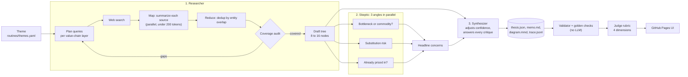
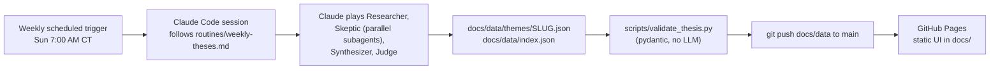

# Thesis Builder

**A multi-agent research pipeline that turns an investment theme ("AI infrastructure", "Energy transition", "Robotics") into a stress-tested value-chain thesis.** A Researcher maps the chain from cited sources (raw inputs, enabling layers, integrators, applications, with public tickers, private names, catalysts and risks). A Skeptic then attacks every node from three angles in parallel, and a Synthesizer has to answer each critique before anything is published. The point of the project is the agent design: an adversarial review step that measurably changes the output, typed contracts between agents, and an eval harness with golden specs. By default it runs weekly as a scheduled Claude session, so it costs nothing in API fees.

**Live demo:** https://ankittalwar07.github.io/thesis-builder/

> Not investment advice. This is an engineering demo of agent orchestration. Its output may be incomplete or wrong.

## Architecture



| Agent | What it does |
|---|---|
| **Researcher** | Plans searches across the four layers, summarizes each source in a map-reduce pass, loops until a coverage audit passes, then drafts the node tree with citations. |
| **Skeptic** | Critiques every draft node from three angles (bottleneck vs. commodity, substitution risk, priced in) in parallel, each with its own evidence pack, then rolls the critiques up into headline concerns. |
| **Synthesizer** | Merges research and critiques into the final thesis, demotes or drops what the Skeptic broke, answers each critique (held, partly conceded, conceded), and writes the memo and Mermaid diagram. |

Every hand-off is a Pydantic model ([`schemas.py`](src/thesis_builder/schemas.py)), and every prompt is versioned in one registry ([`prompts.py`](src/thesis_builder/prompts.py)), so the same contracts drive the live LLM path, the offline demo, and the Claude routine.

## Design highlights

**An adversarial skeptic that changes the answer, not just the tone.** Each node gets three independent attacks, each fed only the four most relevant sources for that node (scored by entity overlap, layer match and relevance in [`skeptic.py`](src/thesis_builder/agents/skeptic.py)). A `weak` verdict must state a failure mode and forces the Synthesizer to demote confidence or drop the node. The Synthesizer must publish a rebuttal for every critique, and the UI shows each critique next to its answer, so a reader can audit whether the pushback was handled honestly.

**An eval harness with golden specs.** [`evals/golden/`](evals/golden) defines hard requirements per theme (minimum nodes and unique sources, all four layers present, at least one named company from each required cluster, minimum critiques). They are checked deterministically, with no LLM. On top of that, an LLM judge ([`evals/judges.py`](evals/judges.py)) scores coverage, specificity, novelty and actionability from 0 to 5 while seeing only the final thesis and memo, never the research notes, so it cannot simply re-summarize the inputs. The rubric is told that a generic thesis scores 2.

**Cost-aware routing on the live path.** Three model tiers through LiteLLM ([`config/models.yaml`](config/models.yaml)): a cheap tier for high-volume source summaries, a mid tier for critiques, and the expensive tier only for the single synthesis pass (with Anthropic prompt caching). Fallback chains, per-agent token budgets, a hard cost cap (`THESIS_MAX_COST_USD`), disk caching keyed by prompt version, and a `trace.jsonl` of every call.

## How it runs with no API cost



The default mode is a **scheduled Claude Code routine**. Instead of paying per token for API calls, a weekly Claude session acts as the three agents itself, following the repo's own prompts and schemas. [`routines/weekly-theses.md`](routines/weekly-theses.md) is the complete standalone prompt, and [`routines/themes.yaml`](routines/themes.yaml) lists the themes. The session writes one JSON file per theme to `docs/data/`, scores it against the eval rubric with a separate judge subagent, runs the no-LLM validator, and commits only `docs/data/`. GitHub Pages serves the static UI in [`docs/`](docs) (vanilla JS, no build step), which reads those files.

| Mode | Who plays the agents | Cost | How to run |
|---|---|---|---|
| **Claude routine** (default) | A scheduled Claude Code session | No per-token API spend | Trigger runs `routines/weekly-theses.md` |
| **Demo** | The real LangGraph pipeline with stubbed LLM and search | Free, offline | `uv run thesis --demo "Robotics"` |
| **Live** (secondary) | LiteLLM across three model tiers | Paid per token, capped | `uv run thesis "Robotics"` with keys in `.env` |

The page ships with sample data from the demo pipeline (marked `sample: true`, with a banner in the UI) until the first scheduled run replaces it.

## Run it locally

Requires Python 3.11+ and [uv](https://docs.astral.sh/uv/).

```bash
uv sync --extra dev

# Offline demo: the real graph with stubbed LLM + search. No keys, no network.
uv run thesis --demo "AI infrastructure"          # writes outputs/ai_infrastructure/
uv run thesis-serve --demo                         # live pipeline UI at http://127.0.0.1:8000/

# The static GitHub Pages UI
python3 -m http.server -d docs 8080                # open http://127.0.0.1:8080/

# Checks (all offline)
uv run pytest -q                                   # demo pipeline, publish contract, validator
uv run python scripts/validate_thesis.py           # validate docs/data
uv run python -m evals.run_eval --demo             # eval plumbing, canned judge scores (*)
```

(*) The Robotics demo pack has fewer sources than its golden spec requires, so this run reports one hard-check failure and exits non-zero. That is the harness doing its job on thin data.

`uv run python scripts/export_demo_data.py` regenerates the sample data in `docs/data/`.

### Live LiteLLM path (optional, paid)

```bash
cp .env.example .env                               # add provider keys
uv run thesis "AI infrastructure" --publish-dir docs/data
uv run python -m evals.run_eval                    # build + judge the three golden themes
```

CLI outputs land in `outputs/<slug>/` (`thesis.json`, `memo.md`, `diagram.mmd`, `trace.jsonl`). `--publish-dir` also writes the JSON the Pages UI reads. Design targets for a live run: at least 15 searches and 30 unique sources, at least 3 critiques that change the synthesis, at least 80% of tokens on the two cheaper tiers, and under $0.40 per run (enforced by the cost cap).

## CI

[`.github/workflows/eval.yml`](.github/workflows/eval.yml) runs on every pull request with **no API keys**: module imports, the offline test suite, the `docs/data` validator, and a syntax check of the UI script. The live golden eval runs only when the repo variable `RUN_GOLDEN_EVAL` is `true` and provider secrets are set.

## Repo layout

```
thesis-builder/
├── routines/
│   ├── weekly-theses.md   # standalone prompt for the scheduled Claude session (default mode)
│   └── themes.yaml        # themes to research + their golden specs
├── docs/                  # GitHub Pages UI (index.html, app.js, style.css)
│   └── data/              # published theses: index.json + themes/<slug>.json
├── src/thesis_builder/
│   ├── agents/            # researcher.py, skeptic.py, synthesizer.py
│   ├── graph.py           # LangGraph wiring + token-budget trimming
│   ├── schemas.py         # Pydantic contracts between agents
│   ├── prompts.py         # versioned prompt registry
│   ├── publish.py         # JSON contract for the Pages UI
│   ├── llm.py             # LiteLLM + Instructor gateway, cost tracking, prompt cache
│   ├── tools.py           # web search, source fetch, EDGAR (disk-cached)
│   ├── demo.py            # offline stub LLM + search
│   ├── cli.py             # `thesis` command
│   └── server.py          # `thesis-serve`: FastAPI + streaming UI in web/
├── evals/
│   ├── golden/            # ai_infra.yaml, energy_transition.yaml, robotics.yaml
│   ├── judges.py          # LLM-judge rubric
│   └── run_eval.py
├── scripts/
│   ├── validate_thesis.py # no-LLM validator for docs/data
│   └── export_demo_data.py
├── tests/                 # offline tests run in CI
├── web/                   # live pipeline UI served by thesis-serve
└── config/models.yaml     # model tiers + fallbacks for the live path
```

## More multi-agent projects

- **Multi-agent AI investment agent**: [repo](https://github.com/ankittalwar07/Multi-agent-AI-investment-agent), [live UI](https://ankittalwar07.github.io/Multi-agent-AI-investment-agent/)
- **AI Demand Watch**: [repo](https://github.com/ankittalwar07/warning-signaks-for-AI-economy-), [live UI](https://ankittalwar07.github.io/warning-signaks-for-AI-economy-/)

## Author

Built by Ankit Talwar. [LINKEDIN LINK NEEDED]

## Disclaimer

Nothing in this repository or on the demo site is investment advice. Theses are produced by automated agents for demonstration, may contain errors, and should not be used to make investment decisions.
